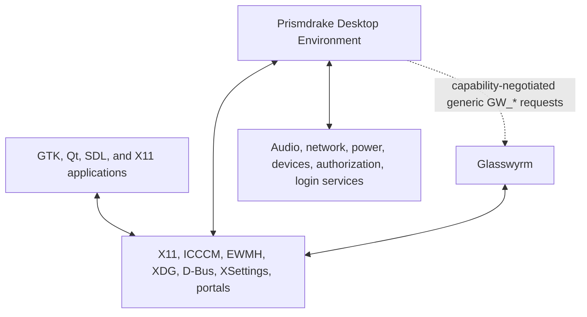
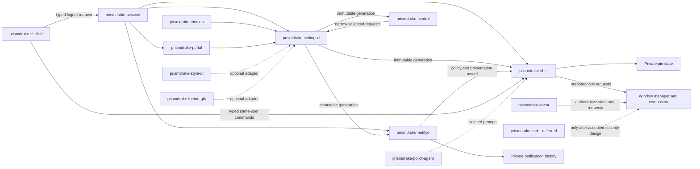

# Architecture overview

The Prismdrake architecture separates presentation, desktop policy, external
system authority, and optional native effects. Component boundaries are
governed by Accepted [ADR 0002](../adr/0002-component-and-process-model.md).

## System context

## Accepted component model

Arrows express startup or data flow, not authority. The window manager and
compositor remain authoritative for window state, focus, stacking, workspaces,
composition, blur, capture, and output policy.

## Ownership summary

| Domain | Authority | Prismdrake behavior |
|---|---|---|
| Window state and policy | Glasswyrm or active WM | Mirror state and send standards/native requests |
| Composition and effects | Glasswyrm or active compositor | Request intent and geometry; select fallbacks |
| Desktop settings | `prismdrake-settingsd` | Validate and publish immutable generations |
| Configured do-not-disturb baseline | `prismdrake-settingsd` | Publish in the complete settings generation |
| Shell presentation and placement | `prismdrake-shell` | Place and render its own surfaces without becoming WM authority |
| Ordered pin state | `prismdrake-shell` | Persist only validated desktop-file identifiers |
| Notification service, effective do-not-disturb, and history | `prismdrake-notifyd` | Own standard lifecycle and route complete presentation state to shell surfaces |
| Logout transaction | `prismdrake-session` | Validate same-user transaction commands and stop exact owned children |
| Application association | Shell display-free identity core | Deterministically associate catalog entries with mirrored WM metadata |
| Audio/network/power/devices | External system services | Present typed adapters and fail softly |
| Authorization | External authority plus isolated agent | Display minimal prompts; fail closed |
| Theme data | `prismdrake-themes` package, resolved by settings service | Consume validated token snapshots |

## Baseline and enhancement paths

The baseline uses XDG, D-Bus, XSettings, ICCCM, EWMH, freedesktop
notifications, StatusNotifierItem, portals, and ordinary alpha or opaque
materials. Optional Glasswyrm enhancements use separately accepted, versioned
`GW_*` capabilities. Missing enhancements never prevent core session startup;
blur falls back to a readable non-blur material and thumbnails fall back to
icons and titles.

PD2 ownership and interaction details are frozen in
[state ownership](pd2-state-ownership.md),
[notification service](notification-service.md),
[surface placement](surface-placement.md),
[shell and session control](shell-control.md), and
[application identity](application-identity.md). The new Prismdrake D-Bus
interfaces are Experimental and same-user; no stable D-Bus, storage, C++, or QML ABI is
promised.

Relevant requirements: `PD-SCOPE-001`, `PD-PLAT-001` through `PD-PLAT-004`,
`PD-COMP-001` through `PD-COMP-010`, and `PD-GW-001` through `PD-GW-010`.
